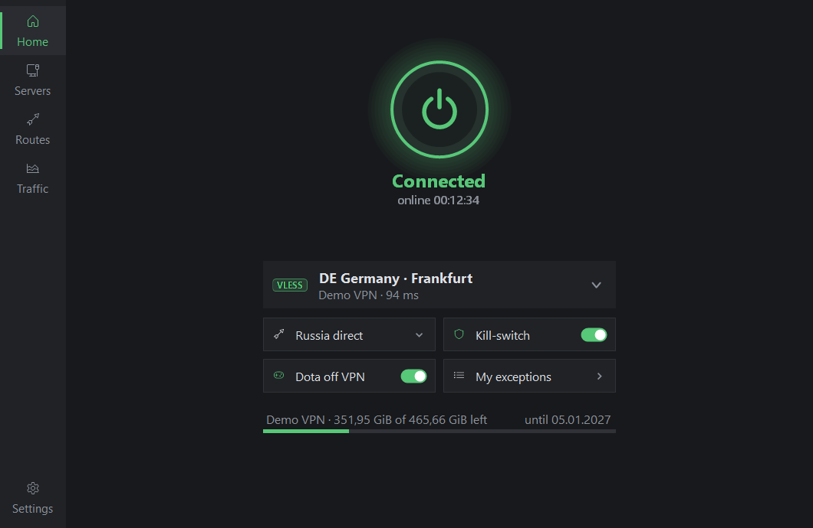
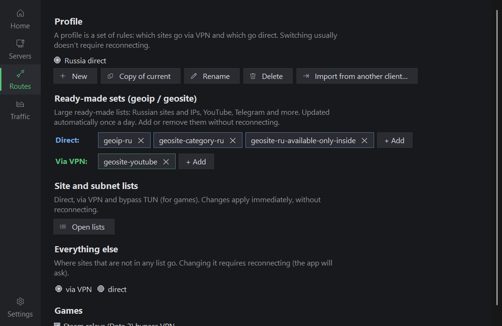

<p align="center">
  
</p>

<h1 align="center">TunPilot</h1>

<p align="center">
  A Windows VPN client with TUN mode that doesn't drop your connection when you change routing.
</p>

<p align="center">
  <a href="https://github.com/dandfovs/tunpilot/releases/latest"></a>
  
  <a href="LICENSE"></a>
</p>

<p align="center">
  <a href="README.md">Русский</a> · <b>English</b>
</p>

<p align="center">
  
</p>

## Why

In most clients, any routing change requires restarting TUN, which drops every connection. If you're in a game at that moment, you get kicked from the match.

In TunPilot, site lists, routing profiles, ready-made geoip/geosite sets, "bypass TUN" exceptions and the selected server all change **on the fly**, without a restart. A reconnect is only needed when you change the "everything else" rule or core settings, and the app always asks first.

## Features

- **TUN mode** powered by [sing-box](https://github.com/SagerNet/sing-box): all system traffic goes through the VPN without setting a proxy in every app.
- **Protocols:** VLESS (Reality, XHTTP, etc.), Hysteria2, WireGuard, plus full Xray configs from your provider via [Xray-core](https://github.com/XTLS/Xray-core).
- **Subscriptions and groups:** several subscriptions and individual keys. Traffic, expiry and provider announcements are shown, with auto-update.
- **Routing without restarts:** choose what goes direct, what goes through the VPN and what bypasses TUN.
- **Gaming:** route Dota 2 and Steam outside the VPN for lower ping.
- **Routing import** from Throne/NekoBox, Happ, v2rayN, v2RayTun and other Xray-based clients, Hiddify/sing-box, Clash/Mihomo.
- **Kill-switch** on the Windows Filtering Platform: internet only through the VPN, and the block survives app crashes and reboots.
- **Latency and speed tests**, "Auto" fastest-server selection, a live speed chart, traffic statistics for 24 hours, 7 and 30 days.
- **Cloudflare WARP** in one click, a local HTTP/SOCKS5 proxy, and core updates from inside the app.
- **Dark and light themes**, Russian and English UI, hotkeys, settings backup.

<p align="center">
  
  
</p>

## Installation

1. Download `TunPilot-Setup-*.exe` from the [latest release](https://github.com/dandfovs/tunpilot/releases/latest).
2. Run the installer. Administrator rights are required, since TUN mode doesn't work without them.
3. In TunPilot open **Servers → Groups → New subscription** and paste the link from your VPN provider. Or copy a `vless://…` key and press Ctrl+V in the main window.
4. Click the big button on the home screen.

The installer works on any Windows 10/11 out of the box: the .NET runtime is bundled with the app. Running a newer installer updates the app and keeps your settings.

> **Windows SmartScreen** may warn that the app is unrecognized because the installer isn't signed with a paid certificate. Click "More info" → "Run anyway". The source code is open, so you can also build it yourself.

## Building from source

Requires the [.NET 10 SDK](https://dotnet.microsoft.com/download).

```powershell
git clone https://github.com/dandfovs/tunpilot.git
cd tunpilot
powershell -ExecutionPolicy Bypass -File get-cores.ps1        # download sing-box and Xray
powershell -ExecutionPolicy Bypass -File build-installer.ps1  # build dist\TunPilot-Setup-<version>.exe
```

For development, `dotnet build TunPilot` is enough. Core binaries are not stored in the repository; `get-cores.ps1` downloads them from the official releases.

## How it works

- **sing-box** creates the TUN adapter and routes traffic. User lists and geoip/geosite sets are attached as local rule-sets that sing-box reloads by itself when the file changes, so rules update without a restart.
- **Xray** runs alongside for servers sing-box can't handle (XHTTP, full provider configs). sing-box hands traffic to it over local SOCKS ports.
- **The server** is switched through the sing-box Clash API, also without a restart.
- **"Bypass TUN" exceptions** are plain Windows routes through the physical gateway, so those connections don't depend on the VPN at all.

Settings, subscriptions and logs are stored in `%LOCALAPPDATA%\TunPilot`.

## License

TunPilot is licensed under the [GNU GPL v3.0](LICENSE): you can use, study, modify and share it, and modified versions must stay open source too.

The installer bundles third-party components:

| Component | License |
|---|---|
| [sing-box](https://github.com/SagerNet/sing-box) | GPL-3.0 |
| [Xray-core](https://github.com/XTLS/Xray-core) | MPL-2.0 |
| [Rule sets for Russia](https://github.com/runetfreedom/russia-v2ray-rules-dat) (downloaded at runtime) | GPL-3.0 |

TunPilot is only a client: it doesn't provide any VPN servers. Use it in accordance with the laws of your country.
