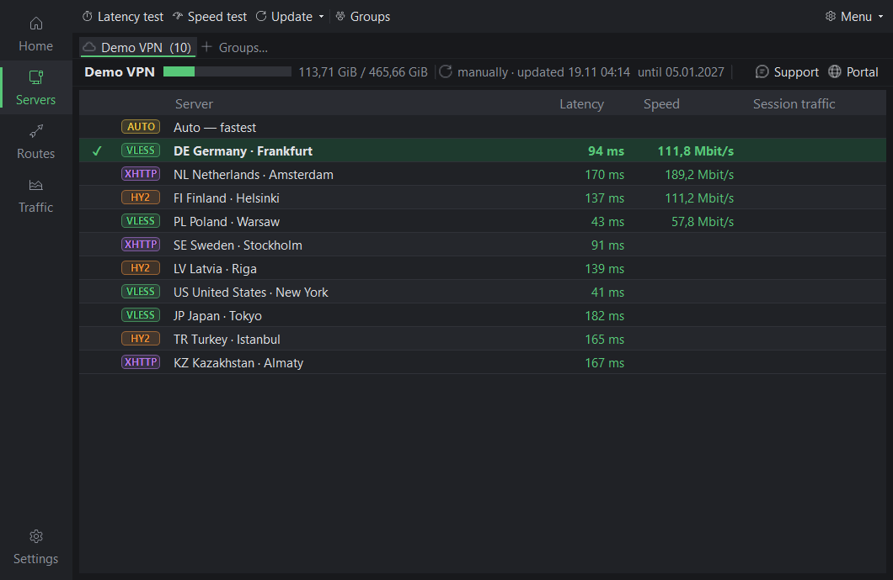

<p align="center">
  
</p>

<h1 align="center">TunPilot</h1>

<p align="center">
  A Windows VPN client with TUN mode that doesn't drop your connection when you change routing.
</p>

<p align="center">
  <a href="https://github.com/dandfovs/tunpilot/releases/latest"></a>
  
  
  <a href="LICENSE"></a>
</p>

<p align="center">
  <a href="README.md">Русский</a> · <b>English</b>
</p>

<p align="center">
  
</p>

## Why

In most clients, any routing change requires restarting TUN, which drops every connection. If you're in a game at that moment, you get kicked from the match.

In TunPilot, site lists, routing profiles, ready-made geoip/geosite sets, "bypass TUN" exceptions and the selected server all change **on the fly**, without a restart. A reconnect is only needed when you change the "everything else" rule or core settings, and the app always asks first.

## Features

- **TUN mode** powered by [sing-box](https://github.com/SagerNet/sing-box): all system traffic goes through the VPN without setting a proxy in every app.
- **Protocols:** VLESS (Reality, XHTTP, etc.), Hysteria2, WireGuard, plus full Xray configs from your provider via [Xray-core](https://github.com/XTLS/Xray-core).
- **Subscriptions and groups:** several subscriptions and individual keys. Traffic, expiry and provider announcements are shown, with auto-update.
- **Routing without restarts:** choose what goes direct, what goes through the VPN and what bypasses TUN.
- **Gaming:** route Dota 2 and Steam outside the VPN for lower ping.
- **Routing import** from Throne/NekoBox, Happ, v2rayN, v2RayTun and other Xray-based clients, Hiddify/sing-box, Clash/Mihomo.
- **Kill-switch** (Windows Filtering Platform on Windows, nftables on Linux): internet only through the VPN, and the block survives app crashes and reboots.
- **Latency and speed tests**, "Auto" fastest-server selection, a live speed chart, traffic statistics for 24 hours, 7 and 30 days.
- **Cloudflare WARP** in one click, a local HTTP/SOCKS5 proxy, and core updates from inside the app.
- **Dark and light themes**, Russian and English UI, hotkeys, settings backup.

<p align="center">
  
  
</p>

## Installation

### Windows

1. Download the installer from the [latest release](https://github.com/dandfovs/tunpilot/releases/latest):
   - `TunPilot-Setup-<version>.exe` — for regular PCs (x64);
   - `TunPilot-Setup-<version>-arm64.exe` — for ARM computers (Snapdragon, etc.). If you pick the wrong one, the installer will tell you.
2. Run the installer. Administrator rights are required, since TUN mode doesn't work without them.
3. In TunPilot open **Servers → Groups → New subscription** and paste the link from your VPN provider. Or copy a `vless://…` key and press Ctrl+V in the main window.
4. Click the big button on the home screen.

The installer works on any Windows 10/11 out of the box: the .NET runtime is bundled with the app. Running a newer installer updates the app and keeps your settings.

> **Windows SmartScreen** may warn that the app is unrecognized because the installer isn't signed with a paid certificate. Click "More info" → "Run anyway". The source code is open, so you can also build it yourself.

### Linux

The packages are on the same [latest release](https://github.com/dandfovs/tunpilot/releases/latest) page. For ARM computers, pick the `arm64` / `aarch64` files.

```bash
# Ubuntu, Debian, Linux Mint, etc.
sudo apt install ./tunpilot_<version>_amd64.deb
# Fedora, RHEL, openSUSE, etc.
sudo dnf install ./tunpilot-<version>-1.x86_64.rpm
# anything else: the tar.gz archive
tar xzf tunpilot-<version>-linux-x64.tar.gz && sudo tunpilot-<version>-linux-x64/install.sh
```

TunPilot shows up in the applications menu. The app runs as a regular user: only the sing-box core gets the TUN capabilities (`setcap`), and the kill-switch and bypass routes are changed by a small helper through polkit. It needs `nftables` and `iproute2`; the package installs them. The tray icon works in KDE, Xfce, Cinnamon and others; GNOME needs the AppIndicator extension, otherwise the app simply runs as a window.

To remove the kill-switch manually: `sudo /opt/tunpilot/tunpilot-helper ks-disable`. Uninstalling the package removes it automatically.

## Building from source

Requires the [.NET 10 SDK](https://dotnet.microsoft.com/download).

```powershell
git clone https://github.com/dandfovs/tunpilot.git
cd tunpilot
powershell -ExecutionPolicy Bypass -File get-cores.ps1        # download sing-box and Xray
powershell -ExecutionPolicy Bypass -File build-installer.ps1  # build x64 and ARM64 installers into dist\
```

Linux packages are built by `build-linux.ps1` (via WSL: .deb and .tar.gz in Ubuntu, .rpm in Fedora) or by `TunPilot.Linux/packaging/build-packages.sh` directly on Linux.

For development, `dotnet build TunPilot.slnx` is enough. Core binaries are not stored in the repository; `get-cores.ps1` downloads them from the official releases.

## How it works

- **sing-box** creates the TUN adapter and routes traffic. User lists and geoip/geosite sets are attached as local rule-sets that sing-box reloads by itself when the file changes, so rules update without a restart.
- **Xray** runs alongside for servers sing-box can't handle (XHTTP, full provider configs). sing-box hands traffic to it over local SOCKS ports.
- **The server** is switched through the sing-box Clash API, also without a restart.
- **"Bypass TUN" exceptions** are plain Windows routes through the physical gateway (on Linux, `ip rule` entries placed before the sing-box rules), so those connections don't depend on the VPN at all.

Settings, subscriptions and logs are stored in `%LOCALAPPDATA%\TunPilot` (on Linux, `~/.local/share/TunPilot`).

### Project layout

| Folder | Contents |
|---|---|
| `TunPilot.Core` | Shared core with no UI and no Windows dependencies: subscriptions, groups, profiles, sing-box/Xray config generation, core management, import from other clients, updates, translations. Shared by Windows and Linux. |
| `TunPilot` | The Windows app: UI (WinForms), tray, WFP kill-switch, bypass-TUN routes, autostart. |
| `TunPilot.Linux` | The Linux app: UI (Avalonia), tray, nftables kill-switch, bypass-TUN routes, XDG autostart; `packaging` holds the helper, the polkit policy and the package build. |
| `Setup` | Installer and uninstaller (.NET Framework 4.8). |

## License

TunPilot is licensed under the [GNU GPL v3.0](LICENSE): you can use, study, modify and share it, and modified versions must stay open source too.

The installer bundles third-party components:

| Component | License |
|---|---|
| [sing-box](https://github.com/SagerNet/sing-box) | GPL-3.0 |
| [Xray-core](https://github.com/XTLS/Xray-core) | MPL-2.0 |
| [Rule sets for Russia](https://github.com/runetfreedom/russia-v2ray-rules-dat) (downloaded at runtime) | GPL-3.0 |

TunPilot is only a client: it doesn't provide any VPN servers. Use it in accordance with the laws of your country.
