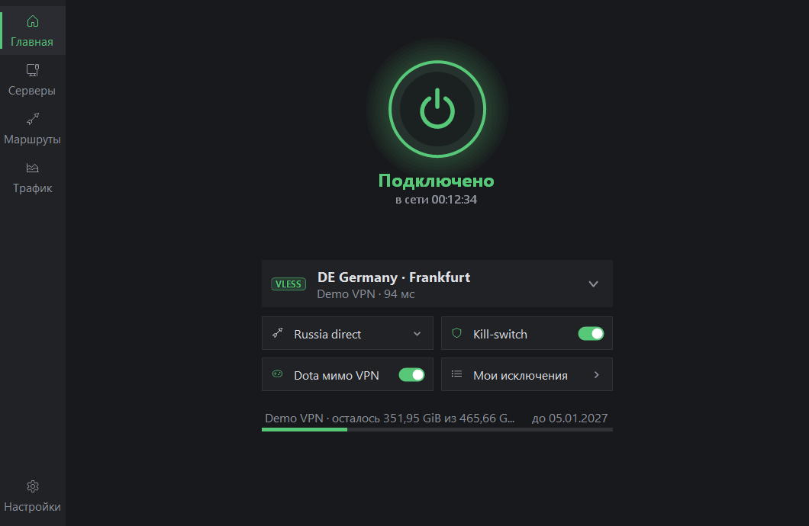
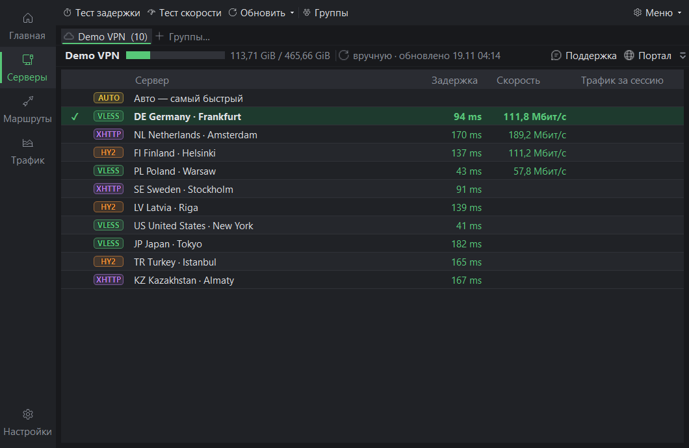
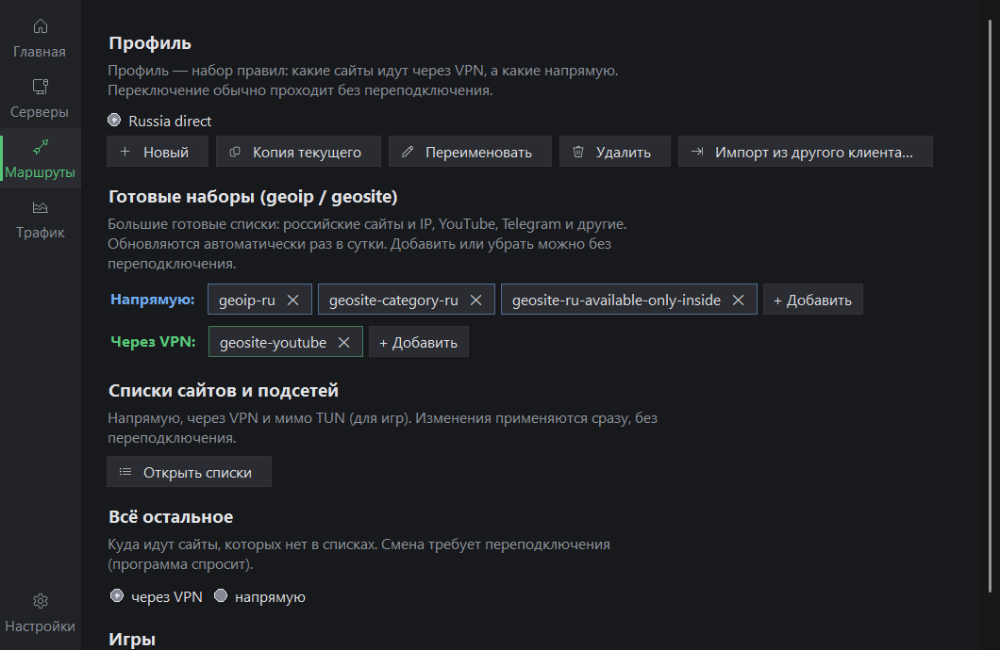

<p align="center">
  
</p>

<h1 align="center">TunPilot</h1>

<p align="center">
  VPN-клиент для Windows с TUN-режимом, который не рвёт соединение, когда вы меняете маршруты.
</p>

<p align="center">
  <a href="https://github.com/dandfovs/tunpilot/releases/latest"></a>
  
  <a href="LICENSE"></a>
</p>

<p align="center">
  <b>Русский</b> · <a href="README.en.md">English</a>
</p>

<p align="center">
  
</p>

## Зачем

В большинстве клиентов любое изменение маршрутизации требует перезапуска TUN, а значит обрыва всех соединений. Если вы в этот момент в игре, вас выкинет из матча.

В TunPilot списки сайтов, профили маршрутов, готовые наборы geoip/geosite, исключения «мимо TUN» и выбор сервера меняются **на лету**, без перезапуска. Переподключение нужно только при смене правила «всё остальное» или настроек ядра, и программа всегда спрашивает, прежде чем его сделать.

## Возможности

- **TUN-режим** на [sing-box](https://github.com/SagerNet/sing-box): весь трафик системы идёт через VPN без настройки прокси в каждой программе.
- **Протоколы:** VLESS (Reality, XHTTP и др.), Hysteria2, WireGuard, а также полные конфиги Xray от провайдера через [Xray-core](https://github.com/XTLS/Xray-core).
- **Подписки и группы:** несколько подписок и отдельные ключи. Видно трафик, срок действия и объявления провайдера, есть автообновление.
- **Маршруты без перезапуска:** что идёт напрямую, что через VPN, что мимо TUN.
- **Игры:** Dota 2 и Steam можно пустить мимо VPN, будет ниже пинг.
- **Импорт маршрутизации** из Throne/NekoBox, Happ, v2rayN, v2RayTun и других клиентов на Xray, Hiddify/sing-box, Clash/Mihomo.
- **Kill-switch** на Windows Filtering Platform: интернет только через VPN, блокировка переживает падение программы и перезагрузку.
- **Тесты задержки и скорости**, «Авто»-выбор самого быстрого сервера, график скорости, статистика трафика за 24 часа, 7 и 30 дней.
- **Cloudflare WARP** в один клик, локальный HTTP/SOCKS5-прокси, обновление ядер из самой программы.
- **Тёмная и светлая темы**, русский и английский интерфейс, горячие клавиши, резервная копия настроек.

<p align="center">
  
  
</p>

## Установка

1. Скачайте `TunPilot-Setup-*.exe` со страницы [последнего выпуска](https://github.com/dandfovs/tunpilot/releases/latest).
2. Запустите установщик. Нужны права администратора, без них TUN-режим не работает.
3. В TunPilot откройте **Серверы → Группы → Новая подписка** и вставьте ссылку от вашего VPN-провайдера. Либо скопируйте ключ `vless://…` и нажмите Ctrl+V в главном окне.
4. Нажмите большую кнопку на главном экране.

Установщик сам по себе работает на любой Windows 10/11: среда .NET встроена в программу. Повторный запуск установщика обновляет программу, настройки сохраняются.

> **Windows SmartScreen** может предупредить, что программа неизвестна: установщик не подписан платным сертификатом. Нажмите «Подробнее» → «Выполнить в любом случае». Исходный код открыт, и вы можете собрать программу сами.

## Сборка из исходников

Нужен [.NET 10 SDK](https://dotnet.microsoft.com/download).

```powershell
git clone https://github.com/dandfovs/tunpilot.git
cd tunpilot
powershell -ExecutionPolicy Bypass -File get-cores.ps1        # скачать sing-box и Xray
powershell -ExecutionPolicy Bypass -File build-installer.ps1  # собрать dist\TunPilot-Setup-<версия>.exe
```

Для разработки достаточно `dotnet build TunPilot`. Двоичные файлы ядер в репозиторий не входят, их скачивает `get-cores.ps1` из официальных выпусков.

## Как это устроено

- **sing-box** поднимает TUN-адаптер и маршрутизирует трафик. Пользовательские списки и наборы geoip/geosite подключены как локальные rule-set, которые sing-box перечитывает сам при изменении файла. Поэтому правила меняются без перезапуска.
- **Xray** запускается рядом для серверов, которые sing-box не умеет (XHTTP, полные конфиги провайдера). sing-box передаёт ему трафик через локальные SOCKS-порты.
- **Сервер** переключается через Clash API sing-box, тоже без перезапуска.
- **Исключения «мимо TUN»** — это обычные маршруты Windows через физический шлюз: такие соединения не зависят от VPN вообще.

Настройки, подписки и логи хранятся в `%LOCALAPPDATA%\TunPilot`.

## Лицензия

TunPilot распространяется по лицензии [GNU GPL v3.0](LICENSE): программу можно использовать, изучать, менять и распространять, а изменённые версии тоже должны оставаться открытыми.

В установщик входят сторонние компоненты:

| Компонент | Лицензия |
|---|---|
| [sing-box](https://github.com/SagerNet/sing-box) | GPL-3.0 |
| [Xray-core](https://github.com/XTLS/Xray-core) | MPL-2.0 |
| [Наборы правил для России](https://github.com/runetfreedom/russia-v2ray-rules-dat) (скачиваются при работе) | GPL-3.0 |

TunPilot — только клиент: он не предоставляет VPN-серверов. Используйте его в соответствии с законами вашей страны.
